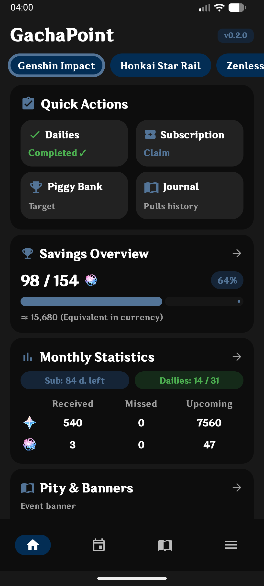
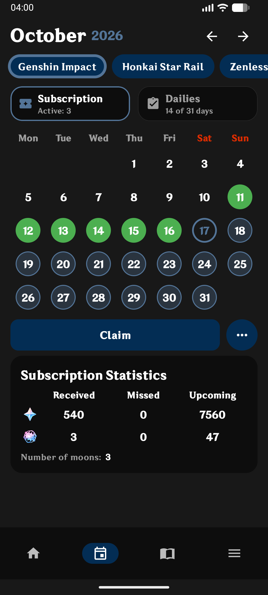
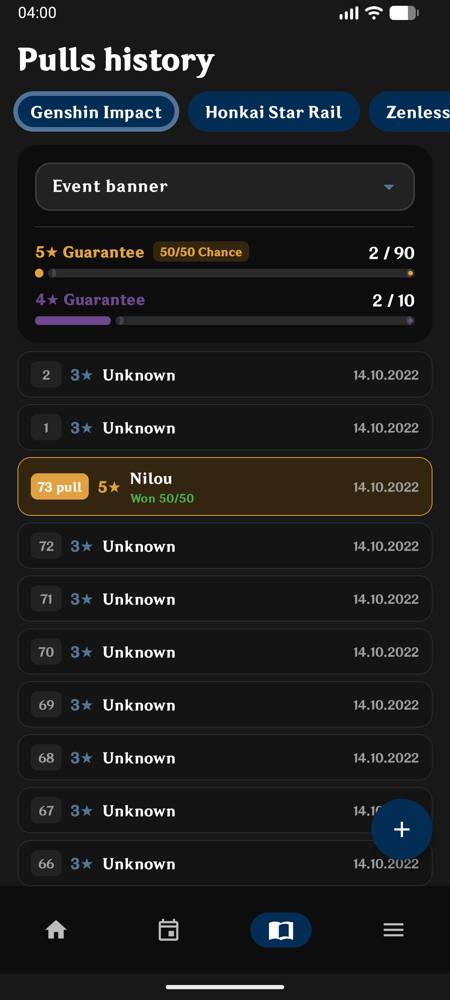
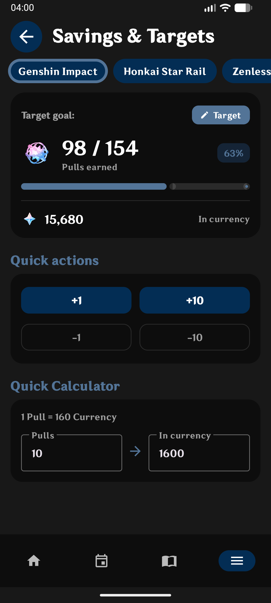
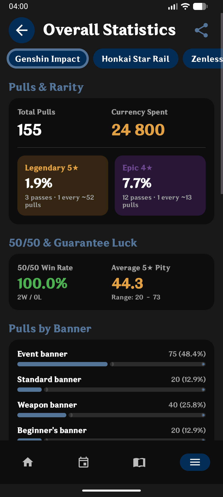
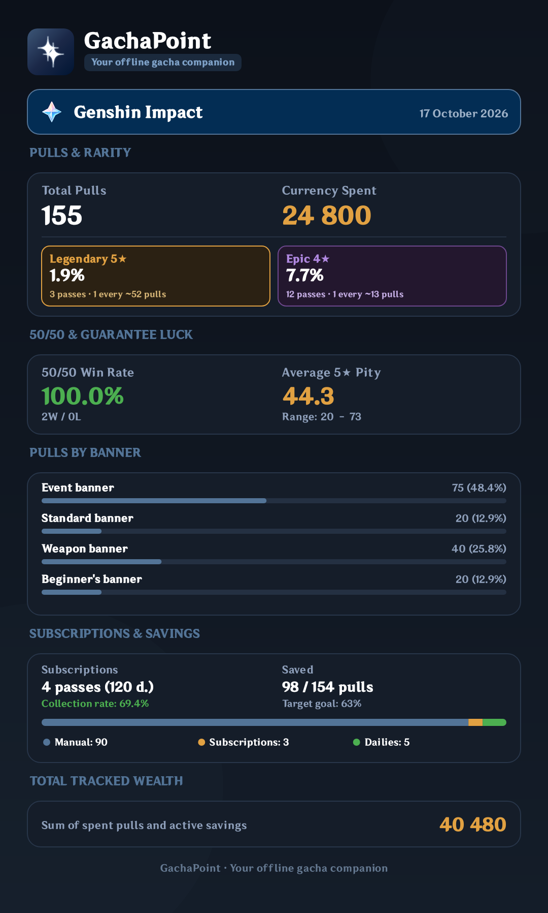
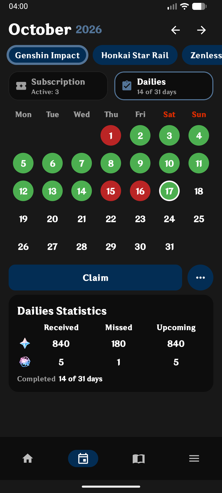
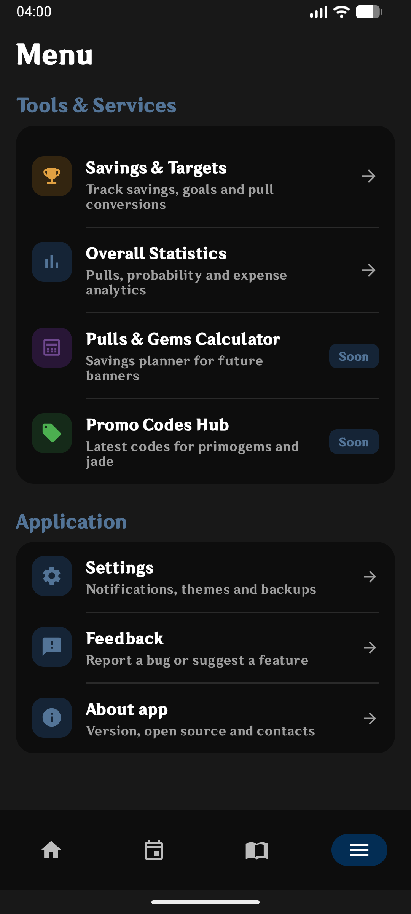

[English](README.md) | [Русский](README.ru.md)

<p align="center">
  
</p>

<h1 align="center">GachaPoint</h1>

<p align="center">
  An open-source companion app for Genshin Impact, Honkai: Star Rail, Zenless Zone Zero, and Honkai Impact 3rd.
</p>

<p align="center">
  <a href="https://github.com/MenshovAnton/GachaPoint/releases"></a>
  
  <a href="LICENSE"></a>
  <a href="https://t.me/GachaPoint_official"></a>
</p>

---

## Overview

**GachaPoint** helps you organize in-game progress, track wish histories, and manage daily subscriptions across your favorite HoYoverse titles without needing your personal account credentials.

### Core Principles

- **Account Safety:** GachaPoint does not ask for your game passwords, cookies, or auth tokens. Your game account remains completely safe from bans or credential leaks.
- **Local Storage:** All your logs, summon histories, targets, and statistics are stored locally on your device in a Room database.
- **Privacy First:** No hidden telemetry, third-party tracking, or proprietary server dependencies. Any networked utilities (such as the upcoming promo code aggregator) fetch directly from open, public sources without personal data exchange.

---

## Key Features

- **Subscriptions & Dailies Calendar:** Keep track of daily pass claims (Welkin Moon, Express Supply Pass, Inter-Knot Membership, Monthly Card) and daily commissions, monitor missed days, and forecast upcoming resource yields.
- **Pulls & Pity Tracker:** Save summon/wish history across all banner types (event, weapon, standard, and bangboo), with intuitive visual pity gauges (5★ and 4★) and 50/50 win-rate calculation.
- **Savings & Goals:** Monitor saved resources both in raw pulls and currency equivalents, define saving goals for upcoming characters, and use the quick conversion calculator.
- **Analytics & Statistics:** Detailed insights including currency expenditure, 50/50 win-rate percentages, average pulls per 5-star drop, and banner roll distribution.
- **Shareable Stats Card:** Generate and export an attractive summary card showing your personal stats for any selected game.
- **Customizable Home Widgets:** Reorder and toggle dashboard widgets via drag-and-drop to tailor the home screen to your needs.
- **Reminders:** Configurable daily notifications so you never miss claiming your subscription rewards.

---

## Screenshots

| Home Screen | Subscriptions Calendar | Pulls Journal |
|:---:|:---:|:---:|
|  |  |  |

| Savings & Goals | Overall Statistics | Shareable Stats Card |
|:---:|:---:|:---:|
|  |  |  |

<details>
<summary><b>Additional Screens (Dailies & Menu)</b></summary>
<br>

| Dailies Calendar | Services Menu |
|:---:|:---:|
|  |  |

</details>

---

## Download & Installation

Pre-built APK releases are available in the [GitHub Releases](https://github.com/MenshovAnton/GachaPoint/releases) section.

Requirements:
- Android 8.0 (API 26) or higher.

---

## Building from Source

1. Clone the repository:
   ```bash
   git clone https://github.com/MenshovAnton/GachaPoint.git
   ```
2. Open the project in Android Studio (Ladybug or newer recommended, JDK 11+).
3. Allow Gradle to sync dependencies and build:
   ```bash
   ./gradlew assembleDebug
   ```

---

## Tech Stack

- **Language:** Java 11
- **Platform:** Android SDK (Compile SDK 37, Min SDK 26)
- **Architecture:** MVVM, Android Jetpack (ViewModel, LiveData, ViewBinding, Navigation Component)
- **Database:** Room SQLite
- **Background Tasks:** WorkManager
- **UI:** Material Components (Material 3/2), ConstraintLayout

---

## Community & Feedback

- Telegram Channel: [@GachaPoint_official](https://t.me/GachaPoint_official)
- Bug Reports & Feature Requests: [GitHub Issues](https://github.com/MenshovAnton/GachaPoint/issues)
- Developer: [@MenshovAnton](https://github.com/MenshovAnton)

---

## License

This project is licensed under the [Apache-2.0 License](LICENSE).  
Copyright © 2024–2026 Anton Menshov.

---

## Legal Disclaimer

GachaPoint is an independent fan-made project and is **not affiliated with, endorsed by, or sponsored by COGNOSPHERE PTE. LTD. or miHoYo Co., Ltd.**

Genshin Impact™, Honkai: Star Rail™, Zenless Zone Zero™, and their respective logos, names, graphical assets, characters, and in-game item identifiers are registered trademarks and intellectual property of **COGNOSPHERE PTE. LTD.** and/or **miHoYo Co., Ltd.** All assets are used for informative and non-commercial purposes under fair use principles and fan content guidelines.