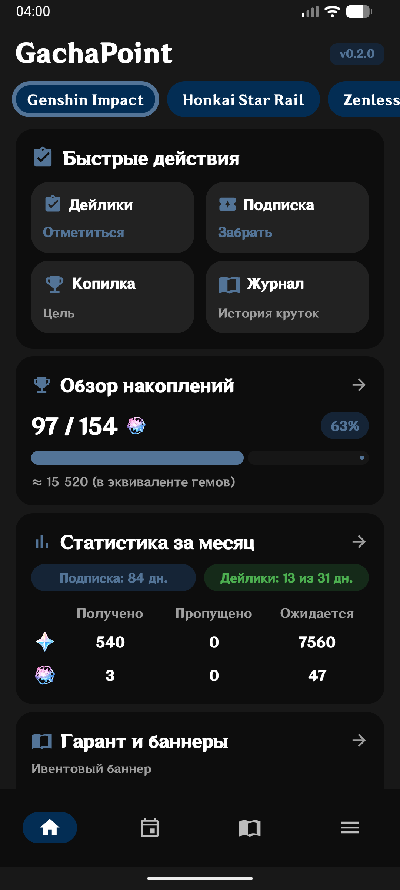
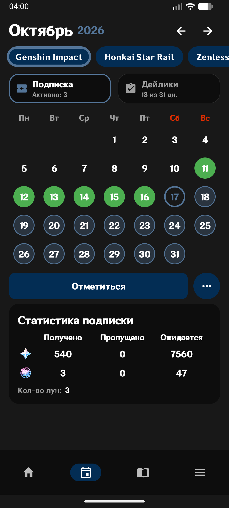
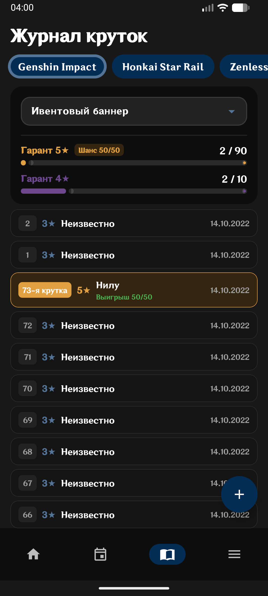
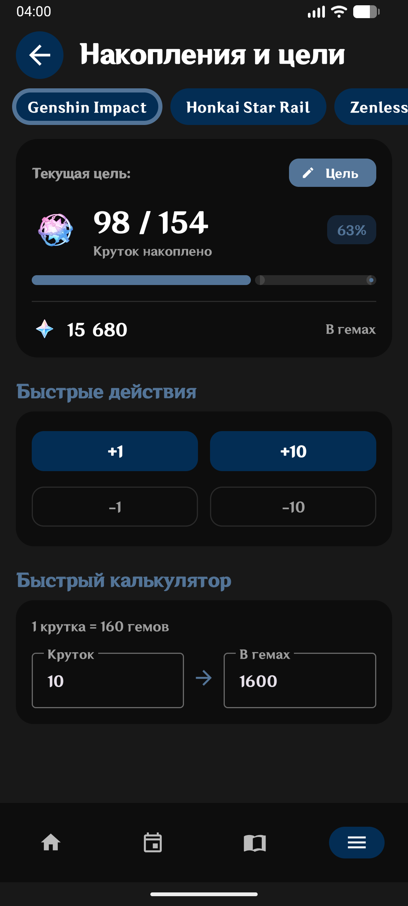
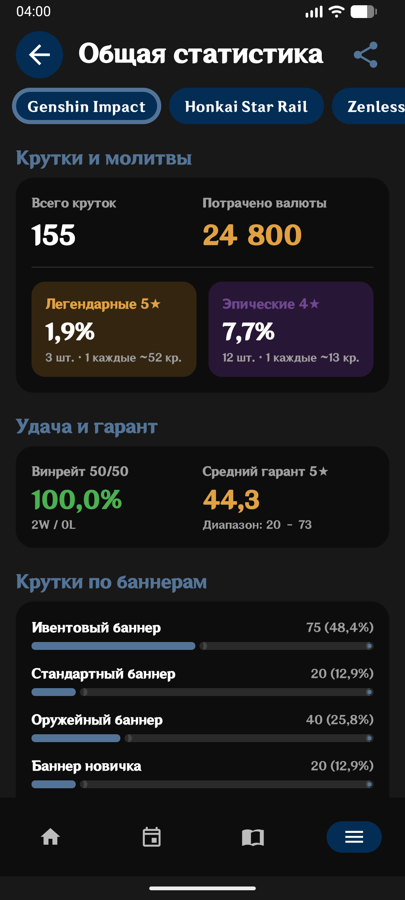
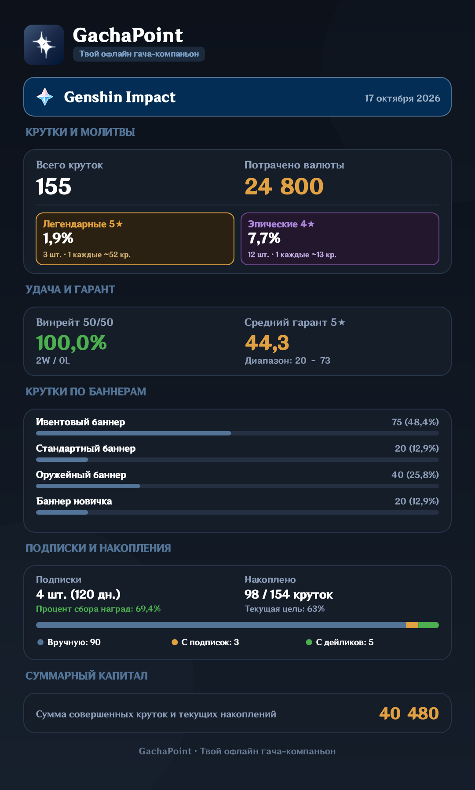
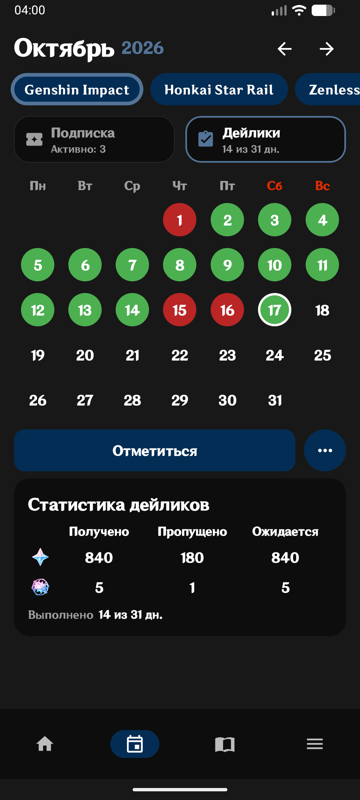
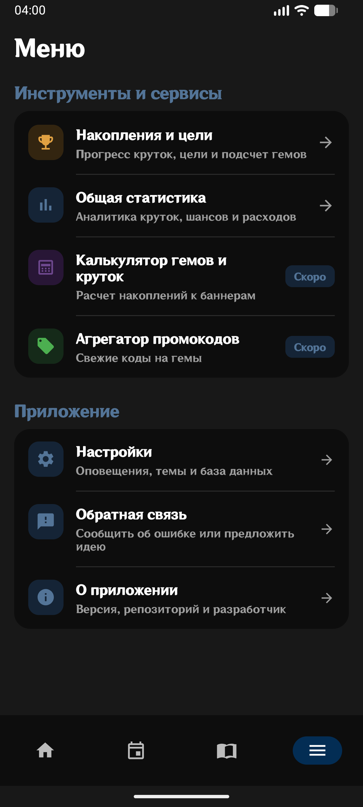

[English](README.md) | [Русский](README.ru.md)

<p align="center">
  
</p>

<h1 align="center">GachaPoint</h1>

<p align="center">
  Универсальный компаньон с открытым исходным кодом для игроков в Genshin Impact, Honkai: Star Rail, Zenless Zone Zero и Honkai Impact 3rd.
</p>

<p align="center">
  <a href="https://github.com/MenshovAnton/GachaPoint/releases"></a>
  
  <a href="LICENSE"></a>
  <a href="https://t.me/GachaPoint_official"></a>
</p>

---

## О проекте

**GachaPoint** помогает комфортно управлять ресурсами и отслеживать игровой прогресс в любимых гача-играх от HoYoverse без необходимости вводить личные данные учетной записи.

### Ключевые принципы

- **Безопасность учетной записи:** Приложению не нужны логины, пароли, куки или сессионные токены от ваших игровых аккаунтов. Это исключает любые риски компрометации профиля или блокировок.
- **Локальное хранение:** Все ваши записи, история молитв, цели и персональная статистика сохраняются в локальной базе данных на устройстве (Room DB).
- **Приватность:** Никакой скрытой телеметрии и отслеживания. Любые сетевые функции приложения (например, агрегатор промокодов) обращаются напрямую к открытым публичным источникам без передачи персональных данных.

---

## Возможности

- **Календарь подписок и дейликов:** Наглядный учет сбора наград с ежедневных подписок (Благословение полой луны, Пропуск снабжения, подписка Интернота, Месячная карта) и ежедневных поручений, подсчет пропущенных дней и прогноз накоплений.
- **Журнал круток и гарант:** Детальный учет молитв, прыжков и сигналов по всем баннерам (ивентовые, оружейные, стандартный, банбу), наглядная шкала гаранта (5★ и 4★) и расчет шанса 50/50.
- **Накопления и цели:** Быстрый подсчет доступных ресурсов в валюте и крутках, отслеживание прогресса до заданной цели и экспресс-калькулятор.
- **Общая статистика и аналитика:** Средний расход валюты, статистика выигрышей 50/50, среднее количество круток до легендарных наград и распределение по типам баннеров.
- **Карточка шеринга:** Возможность сгенерировать и экспортировать стильное резюме вашей статистики по выбранной игре.
- **Кастомизация главного экрана:** Гибкое управление виджетами с поддержкой сортировки через Drag-and-Drop.
- **Напоминания:** Настраиваемые ежедневные уведомления, чтобы не забыть забрать награды подписки.

---

## Скриншоты

| Главный экран | Календарь подписок | Журнал круток |
|:---:|:---:|:---:|
|  |  |  |

| Накопления и цели | Общая статистика | Карточка шеринга |
|:---:|:---:|:---:|
|  |  |  |

<details>
<summary><b>Дополнительные экраны (дейлики и меню)</b></summary>
<br>

| Календарь дейликов | Меню сервисов |
|:---:|:---:|
|  |  |

</details>

---

## Установка

Готовые установочные файлы (APK) доступны в разделе [GitHub Releases](https://github.com/MenshovAnton/GachaPoint/releases).

Требования:
- Android 8.0 (API 26) или новее.

---

## Сборка из исходников

1. Клонируйте репозиторий:
   ```bash
   git clone https://github.com/MenshovAnton/GachaPoint.git
   ```
2. Откройте проект в Android Studio (рекомендуется Ladybug или новее, JDK 11+).
3. Дождитесь синхронизации Gradle и выполните сборку:
   ```bash
   ./gradlew assembleDebug
   ```

---

## Технологический стек

- **Язык:** Java 11
- **Платформа:** Android SDK (Compile SDK 37, Min SDK 26)
- **Архитектура:** MVVM, Android Jetpack (ViewModel, LiveData, ViewBinding, Navigation Component)
- **База данных:** Room SQLite
- **Фоновые задачи:** WorkManager
- **UI:** Material Components (Material 3/2), ConstraintLayout

---

## Сообщество и обратная связь

- Telegram-канал: [@GachaPoint_official](https://t.me/GachaPoint_official)
- Ошибки и предложения: [GitHub Issues](https://github.com/MenshovAnton/GachaPoint/issues)
- Автор проекта: [@MenshovAnton](https://github.com/MenshovAnton)

---

## Лицензия

Проект распространяется под свободной лицензией [Apache 2.0](LICENSE).  
Copyright © 2024–2026 Anton Menshov.

---

## Отказ от ответственности (Legal Disclaimer)

GachaPoint является независимым фанатским проектом и не связан с компаниями **COGNOSPHERE PTE. LTD.** или **miHoYo Co., Ltd.**, не одобрен и не спонсируется ими.

Genshin Impact™, Honkai: Star Rail™, Zenless Zone Zero™, а также соответствующие логотипы, названия, графические материалы, персонажи и обозначения внутриигровых предметов являются зарегистрированными товарными знаками и интеллектуальной собственностью **COGNOSPHERE PTE. LTD.** и/или **miHoYo Co., Ltd.** Все используемые материалы принадлежат их законным правообладателям и задействованы исключительно в информационных и некоммерческих целях в рамках концепции добросовестного использования (Fair Use) и политики фанатского контента.